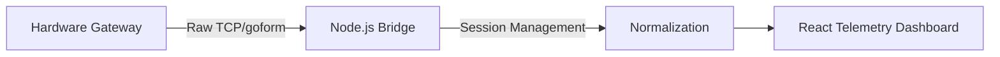

# SPECTRS
 **Spectrum Passive Emergency, Crisis & Tactical Response System**

[]()
[]()

## Executive Summary
**SPECTRS** is a modular RF signal monitoring and analysis framework. The system is designed to provide high-fidelity spectrum awareness and cellular infrastructure intelligence in contested or infrastructure-denied environments. By integrating directly with hardware interfaces through low-level socket programming, SPECTRS offers a transparent, passive look at signal health, carrier infrastructure, and communications.

## Technical Architecture

SPECTRS operates as a bridge between closed-source hardware gateways and a centralized telemetry dashboard.


    
### Current Technical Specifications (v1.0.0)
The following capabilities are fully implemented in the current test release:

| Capability | Technical Scope | 
| --- | --- |
| Telemetry Extraction | Low-latency polling of RSRP, RSRQ, and RSSI metrics. |
| Infrastructure Intelligence | Automated normalization of Cell IDs & Band calculation. |
| Protocol Authentication | MD5/SHA-256 challenge-response for ``` stok ``` rotation. |
| Gateway Stability | Intelligent ``` OFFLINE_REFRESHING ``` state management. |


## Engineering Post-Mortem & Implementation Log
Development of the SPECTRS engine involved significant technical challenges related to proprietary, closed-source hardware firmware:

| Issue | Description | Resolution |
| --- | --- | --- |
| Watchdog Mitigation | Direct hardware status polling often triggered modem watchdog timers. | 15ms "breath-loop" pacing algorithm to extract metrics without disrupting device uptime. |
| Firmware Abstraction | Standard API calls were restricted. | Raw TCP socket bridge to perform direct payload injection, effectively bypassing high-level HTTP client restrictions. |
| Session Persistence | The hardware forces frequent token rotation. | Background authentication proxy to manage the full challenge-response lifecycle, abstracting complexity from the user interface. |


## Development Roadmap
This framework is architected for a future transition to software-defined radio (SDR) platforms (e.g., RTL-SDR, LimeSDR). Planned modules include:

| Module | Objective |
| :--- | :--- |
| **Black Box Recorder** | Cyclic buffer logging of cell handovers, RSRP/RSSI drops, and network state changes. | 
| **Offline Triangulation** | GNSS-independent trilateration using internal AT-command neighbor-cell RSSI scanning against offline topography/OpenCelliD databases. | 
| **Automated EMCON** | Burst-transmission & power-throttling to minimize electromagnetic signatures. |
| **IMSI-Catcher Detection** | Heuristic-based anomaly detection for base station spoofing, forced protocol downgrades, and transmission power irregularities |
| **RF Shadow Mapping** | Dynamic LoS calculation using digital elevation models (DEM) to find "Shadow Corridors." — geographic areas where terrain physically blocks signals from interception. |
| **Mesh C2 Gateway** | SMS/Wi-Fi fallback for team comms during infrastructure degradation. |
| **Smart Power Manager** | Adaptive duty-cycling based on network signal lock, state and device thermal load. |

---

## Getting Started

### Prerequisites
* **Runtime:** Node.js, React
* **Dependencies:** `npm install express axios cors dotenv`

### Configuration
1. **Clone & Install**
   
   ```bash
   git clone https://github.com/dw-dev77/SPECTRS.git
   cd SPECTRS
   npm install
   ```
2. **Create a .env file in the root directory:**
   
   ```bash
   MODEM_IP=192.168.0.1
   MODEM_PASSWORD=your_modem_password
   PORT=4000
   ```
3. **Run the engine:**
   
   ```bash
   node server.cjs
   ```
