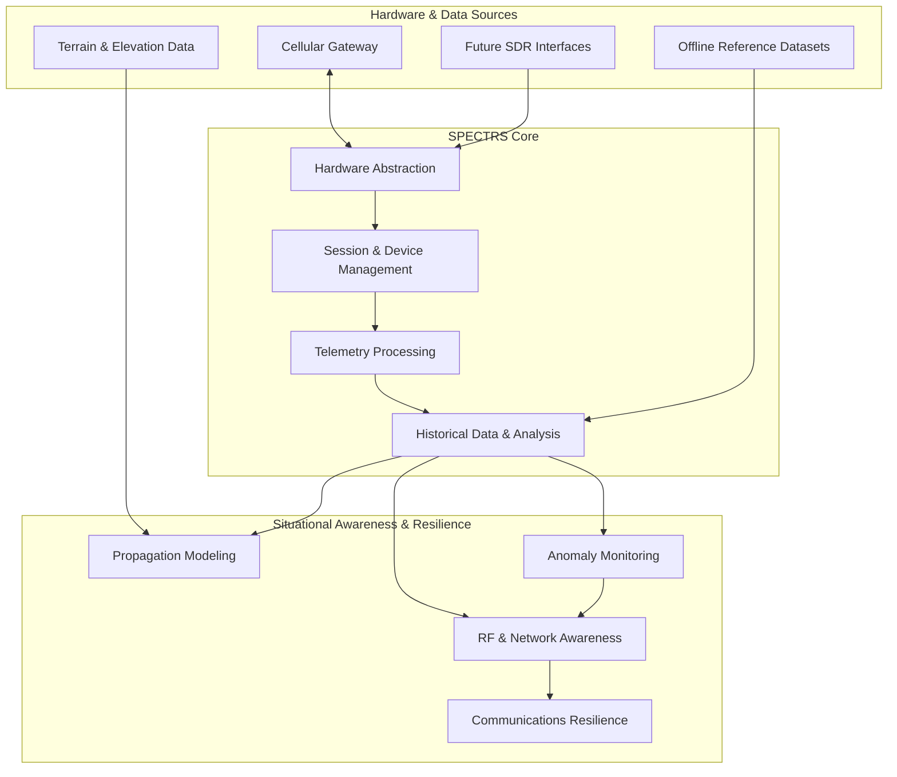

# SPECTRS


## Executive Summary

**SPECTRS** is an experimental RF awareness, cellular infrastructure monitoring, and resilient communications framework designed around operation in degraded, contested, and infrastructure-denied environments.

The project originated as an exploration of a closed-source USB cellular device, investigating how much telemetry and infrastructure information could be extracted beyond its intended user-facing functionality. What began as a hardware-integration experiment evolved into a modular system for device communication, signal telemetry, session management, and centralized monitoring.

The long-term objective is to develop SPECTRS into a broader situational-awareness and communications-resilience platform, combining cellular telemetry, software-defined radio (SDR), offline analysis, terrain-aware propagation modeling, and adaptive system management.

The system is intended to explore a fundamental operational problem:

**How much useful communications and RF situational awareness can be maintained when conventional infrastructure, connectivity, or access to supporting services becomes unreliable?**

SPECTRS is currently an experimental prototype. Its tactical and operational capabilities are a development vision, not a claim that a complete field-deployable system already exists.

**Design philosophy:** Passive RF awareness is a long-term design objective of SPECTRS. The current v1.0.0 implementation relies on active communication with a supported cellular gateway to retrieve device-reported telemetry. Future receiver-based components are intended to support passive RF observation where hardware capabilities permit. Passive sensing, device management, and communications functions are treated as distinct operational capabilities.

## System Architecture

SPECTRS separates hardware interaction, telemetry processing, and visualization to support future expansion beyond its current cellular gateway.



*Conceptual architecture. Future modules and integrations shown here are planned unless explicitly listed as implemented below.*

### Architectural principles

- **Hardware abstraction:** Isolate device-specific communication from application logic.
- **Offline capability:** Reduce dependence on external services for historical analysis and locally available reference data.
- **Graceful degradation:** Preserve useful monitoring and local functionality when connectivity or individual components fail.
- **Operational awareness:** Distinguish current measurements, stale telemetry, device failures, and inferred conditions.
- **Modular expansion:** Allow new hardware interfaces and analysis modules to be introduced without requiring a complete redesign.

## Current Implementation — v1.0.0

The current release focuses on integration with a supported cellular gateway.

| Capability | Implementation |
|---|---|
| Cellular telemetry | Collection of RSRP, RSRQ, and RSSI measurements |
| Cell metadata | Normalization of cell identifiers and supported band information |
| Authentication | Device-specific challenge-response handling and session-token rotation |
| Device-state management | Handling of device refresh and availability transitions, including `OFFLINE_REFRESHING` |
| Telemetry dashboard | Centralized presentation of collected measurements and device status |
| Hardware integration | Backend bridge between the gateway interface and application layer |

The implementation addresses practical constraints associated with closed-source hardware, including restricted interfaces, session lifecycle management, and device-specific stability behavior.

The current release operates at the cellular gateway telemetry layer. It does not yet constitute a general-purpose SDR receiver, a complete RF spectrum analysis suite, or a field-validated tactical communications system.

## Engineering Notes

### Closed-hardware integration

SPECTRS began as an investigation into the capabilities of a device whose firmware and internal implementation were not fully accessible.

The resulting integration layer provides a controlled interface between the hardware and the rest of the application, enabling telemetry acquisition and normalization without coupling the dashboard to device-specific behavior.

### Device stability and recovery

Repeated device interaction introduced stability constraints that required a hardware-specific polling strategy.

The implementation also accounts for device refresh and availability transitions, providing a basis for more explicit recovery policies and resilience mechanisms in future versions.

### Authentication and session management

The gateway's authentication and session lifecycle are managed in the backend rather than delegated to the presentation layer.

This separation provides a foundation for consistent error handling, observability, and future hardware adapters.

*Detailed hardware-specific implementation and protocol information is intentionally omitted from this public overview.*

## Operational Development Roadmap

The following modules describe the intended direction of SPECTRS. They are planned capabilities, not claims of completed functionality.

### 1. RF Awareness & Infrastructure Intelligence

| Module | Objective |
|---|---|
| **Black Box Recorder** | Maintain a rolling history of signal measurements, cell transitions, connectivity loss, and device-state events |
| **SDR Integration** | Introduce receiver interfaces for direct RF acquisition and hardware-dependent signal analysis |
| **Offline Signal Analysis** | Investigate location estimation from available cellular observations and offline reference datasets, with explicit uncertainty and accuracy evaluation |
| **Cellular Anomaly Monitoring** | Analyze observable network parameters for unusual cell behavior, potential spoofing indicators, and unexpected protocol or configuration changes |
| **RF Shadow Mapping** | Combine digital elevation models with propagation assumptions to estimate terrain obstruction, coverage gaps, and potential communication limitations |

**Operational objective:** improve understanding of the surrounding communications environment and identify changes that may affect connectivity, reliability, or the interpretation of available measurements.

Anomalies and propagation estimates will be treated as evidence with limitations, not as guaranteed detection or coverage predictions.

### 2. Communications Resilience & Degraded Operation

| Module | Objective |
|---|---|
| **Mesh Communications Gateway** | Explore interoperable communications interfaces and alternative connectivity paths when conventional infrastructure is degraded |
| **Store-and-Forward Messaging** | Investigate locally queued messages and delayed delivery when connectivity becomes intermittent |
| **Adaptive Power Management** | Adjust monitoring duty cycles according to system state, power availability, and thermal constraints |
| **Graceful Degradation** | Preserve local monitoring, cached data, and essential functionality when external dependencies become unavailable |

**Operational objective:** reduce single points of failure and maintain useful system functionality under unreliable power, connectivity, or infrastructure conditions.

Any communications fallback will depend on compatible hardware, available links, and applicable authorization.

### 3. Electromagnetic Signature & Resource Management

| Module | Objective |
|---|---|
| **EMCON-Oriented Operating Modes** | Explore configurable transmission policies, radio availability controls, and reduced-duty-cycle operation for compatible hardware |
| **Radio Activity Awareness** | Track known device states and observable radio activity where supported by the hardware |
| **Power-Aware Monitoring** | Balance telemetry freshness, receiver availability, power consumption, and device temperature |
| **Operational State Profiles** | Define configurable system behavior for routine monitoring, degraded connectivity, and power-constrained operation |

**Operational objective:** make radio usage and system resource consumption explicit, controllable, and measurable.

The ability to reduce or disable transmissions depends on the underlying hardware and software interfaces. A monitoring application cannot guarantee electromagnetic silence merely by reducing its polling frequency.

### 4. Terrain-Aware Situational Awareness

| Module | Objective |
|---|---|
| **Terrain Analysis** | Use elevation data to estimate geometric line of sight and potential terrain obstruction |
| **Coverage Context** | Combine historical measurements with terrain and reference data to distinguish observed conditions from modeled estimates |
| **Offline Geographic Context** | Support locally available maps and reference datasets without requiring continuous external connectivity |
| **Uncertainty Representation** | Communicate the limitations of measurements, propagation models, and inferred geographic information |

**Operational objective:** provide context for interpreting connectivity and understanding where available communications may be limited.

Terrain obstruction is not equivalent to guaranteed RF concealment or absence of reception. Real propagation depends on frequency, antenna characteristics, reflections, diffraction, and the surrounding environment.

## Development Phases

The roadmap is organized around increasing the system's independence from its original hardware.

**Phase I — Cellular Telemetry**

- Integrate the existing cellular gateway.
- Establish telemetry acquisition and normalization.
- Handle device authentication and availability.
- Present measurements through a centralized dashboard.

**Phase II — Observability & Offline Analysis**

- Introduce historical telemetry and event recording.
- Improve state transitions, error reporting, and recovery behavior.
- Add local reference data and reproducible analysis workflows.
- Establish test coverage for hardware communication and failure conditions.

**Phase III — SDR & RF Analysis**

- Introduce SDR-compatible acquisition interfaces.
- Separate modem-reported metrics from directly acquired RF measurements.
- Develop and validate appropriate signal-processing and analysis components.
- Evaluate measurement quality and hardware compatibility.

**Phase IV — Resilience & Operational Integration**

- Explore communications fallback and store-and-forward mechanisms.
- Develop terrain-aware situational-awareness components.
- Introduce configurable power and radio-management policies.
- Evaluate behavior under simulated connectivity loss and other controlled degraded conditions.

Progression between phases depends on hardware support, implementation maturity, and verification of the relevant capabilities.

## Technology Stack

- **Backend:** Node.js
- **Frontend:** React
- **Hardware integration:** Device-specific gateway interfaces
- **Telemetry:** Cellular signal measurements and normalized metadata
- **Future extensions:** SDR interfaces, offline datasets, geographic analysis, and additional communications adapters

## Getting Started

### Prerequisites

- Node.js and npm
- A compatible cellular gateway accessible on the local network
- The dependencies specified in the repository's package manifests

### Installation

```bash
git clone https://github.com/dw-dev77/SPECTRS.git
cd SPECTRS
npm install
```

Create a local `.env` file using the configuration supported by your installation:

```dotenv
MODEM_IP=192.168.0.1
MODEM_PASSWORD=your_modem_password
PORT=4000
```

Start the backend:

```bash
node server.cjs
```

The frontend may require separate installation and startup commands, depending on the repository structure.

### Security & Deployment Considerations

SPECTRS is an experimental project and is not currently presented as a hardened operational deployment.

- Keep device credentials and environment files out of version control.
- Restrict access to backend services and hardware-management interfaces.
- Treat collected telemetry and infrastructure metadata according to their sensitivity.
- Validate device compatibility and recovery behavior before relying on the system.
- Do not assume that modeled coverage, anomaly indicators, or inferred location estimates represent verified real-world conditions.

## Project Status

**Version:** 1.0.0  
**Maturity:** Experimental prototype  
**Current focus:** Cellular telemetry and closed-hardware integration  
**Long-term direction:** RF awareness, communications resilience, and tactical systems research

SPECTRS explores the intersection of hardware integration, RF and cellular telemetry, infrastructure awareness, and resilient system design.

Its long-term ambition is to evolve from a device-specific monitoring prototype into a modular framework for understanding and managing communications capabilities under constrained and degraded operating conditions.

The roadmap represents a direction for continued engineering and experimentation. Individual capabilities will be considered implemented only when their functionality and limitations have been established through testing.
